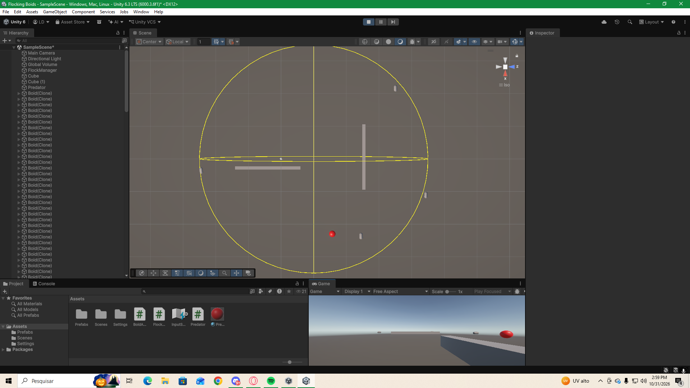
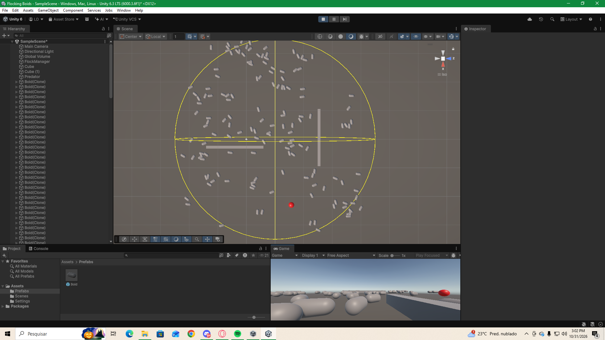
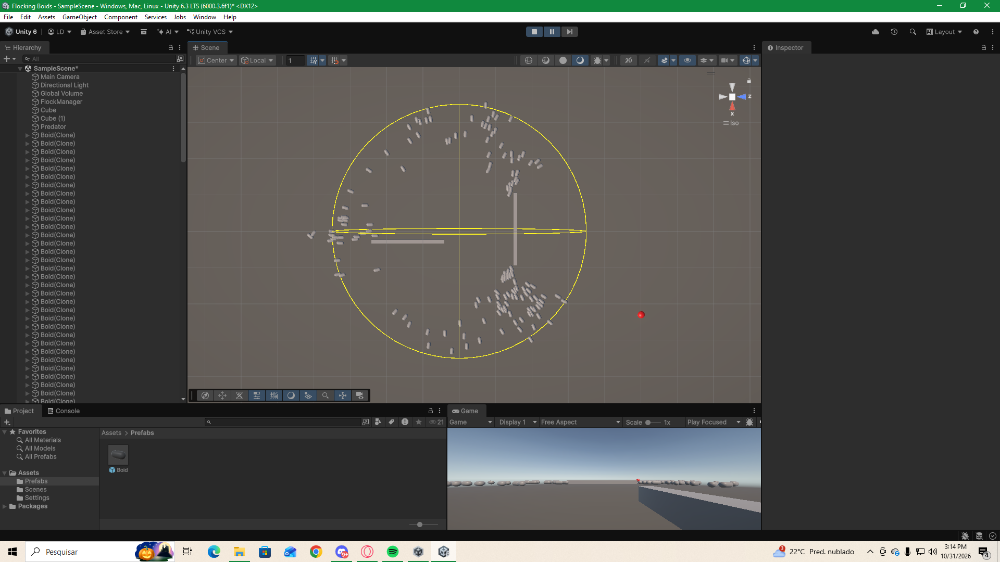
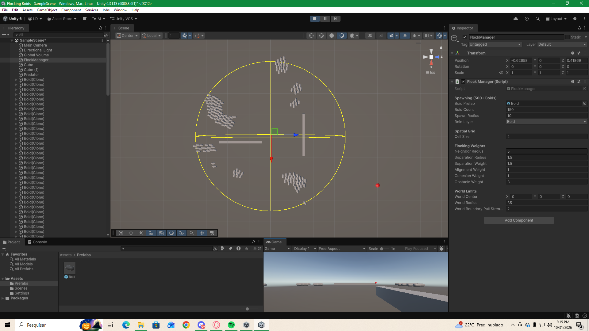
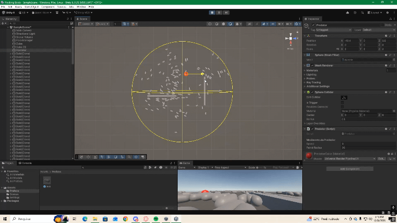

(Flocking Boids)
-

## Integrantes da Equipe
Lais Domingos de Sousa Lima

-

## Instruções para Abrir a Cena Principal
1. Clone ou descarregue este repositório para o seu computador
2. Abra o Unity Hub.
3. Clique em Add > Add project from disk e selecione a pasta raiz deste projeto.
4. Abra o projeto na versão correta do Unity 6.
5. Na janela Project, navegue até a pasta Assets/Scenes.
6. Faça duplo clique na cena principal e clique o botão Play para testar a simulação.

---

## Parâmetros Finais da Simulação
A tabela abaixo detalha os parâmetros e pesos finais configurados no inspetor dos agentes para garantir o comportamento ideal do bando:

| Parâmetro | Valor Final | Descrição |
| :--- | :---: | :--- |
| **Peso da Separação** | *[Inserir Valor]* | Evita a sobreposição e colisões muito próximas entre os boids. |
| **Peso do Alinhamento** | *[Inserir Valor]* | Sincroniza a direção e o vetor de movimento dos agentes vizinhos. |
| **Peso da Coesão** | *[Inserir Valor]* | Atrai os boids para o centro de massa do grupo vizinho. |
| **Raio de Percepção (Neighborhood Radius)** | *[Inserir Valor]* | Distância máxima que cada boid utiliza para detetar os seus vizinhos. |
| **Velocidade Máxima (`maxSpeed`)** | *[Inserir Valor]* | Limite superior de velocidade de deslocamento dos agentes. |
| **Força Máxima (`maxForce`)** | *[Inserir Valor]* | Limite da força de aceleração aplicada nas mudanças de direção. |

Documentação dos testes

## Parte B

1. Peso da Separação = 0
Comportamento Observado: Ao zerar o peso da separação, os agentes perdem a restrição de distância mínima individual. O bando entra em colapso e todos os boids colidem e se aglomeram em pontos densos que lentamente convergem pra se tornarem um só.

2. Peso do Alinhamento = 0
Comportamento Observado: Sem a regra de alinhamento, os agentes continuam mantendo distância e coesão, mas perdem a navegação harmônica em conjunto. O bando se transforma em um enxame caótico, sem direção coletiva definida.

3. Raio de Percepção (0.5 vs 5.0)
Raio de Percepção = 0.5: Os agentes têm campo de visão extremamente limitado, incapazes de detectar vizinhos próximos. O bando se fragmenta em indivíduos isolados ou pequenos grupos perdidos.

Raio de Percepção = 5.0: Permite a comunicação fluida entre uma quantidade ideal de vizinhos, formando bandos mais unificados e orgânicos.

4. Reação ao Predador
Comportamento Observado:Quando o predador se aproxima do grupo, a força de fuga com peso elevado faz com que os boids se dispersem, abrindo caminho para contornar a ameaça e se reagrupando logo após sua passagem.

